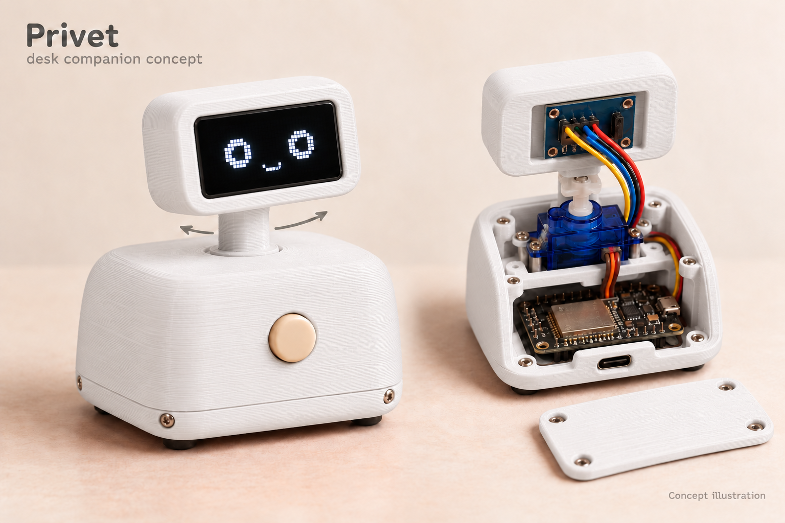
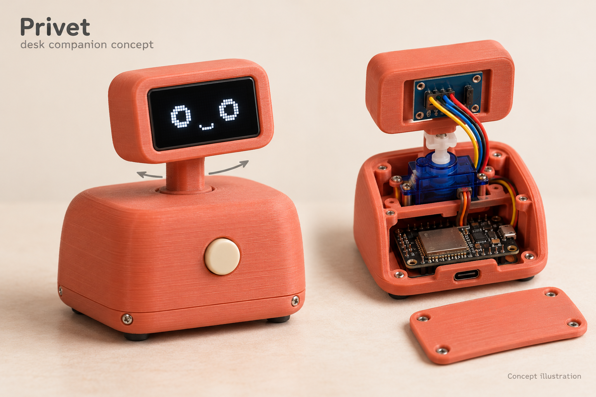

# Privet — Russian learning app and companion prototype

Privet is a React + TypeScript + Vite learning prototype with a native Capacitor iOS app and an optional ESP32 OLED desk companion. The project owner has tested the app and electronics on a real iPhone, including lesson reactions and the latest lock/background connection preservation. This is an electronics prototype, not a finished enclosure or production product. Product naming is centralized in `src/config.ts`.

| Part | Current experience |
| --- | --- |
| Browser website | Landing page, interactive café lesson inside a decorative phone, simulated robot, and enclosure concept gallery. No real Bluetooth connection. |
| Native iOS app | Capacitor selects an app home, profile/statistics and full-screen lesson using `Capacitor.isNativePlatform()`. Content is bundled locally. |
| Virtual companion | Coral SVG/CSS robot with predefined greetings and reactions; works independently of physical hardware. |
| Optional physical companion | ESP32 ESP-32S with SSD1306 128×64 OLED, receiving predefined face/animation commands over native iOS BLE. |

The **phone** owns lessons, answer checking, progress/statistics and optional synthesized pronunciation. The **ESP32** displays predefined OLED faces and animations; it does not check answers or play audio. Lessons remain fully usable without hardware.

## Physical ESP32 OLED companion

Open **Physical companion settings** from native home, tap Connect, choose the advertised companion, and use Test happy reaction. Connect through Privet, rather than manually pairing in iPhone Settings. Bluetooth access is requested only after Connect.

| Accepted lesson event | OLED reaction |
| --- | --- |
| Incorrect answer | Gentle encouraging face |
| Correct answer | Happy face |
| Continue to another exercise or retry | Neutral/idle face |
| Actual lesson completion | Celebration with sparkles |

Opening/closing a lesson, restart, screen changes and fresh connections synchronize IDLE as defined in the protocol. Final Continue sends CELEBRATE only; reopening saved results does not replay it. Hardware feedback never blocks a lesson or replaces lesson/audio feedback.

- Working sketch: [PrivetBLE_Lessons.ino](firmware/PrivetBLE_Lessons/PrivetBLE_Lessons.ino).
- Wiring, Arduino setup, upload and first-run checks: [firmware setup](firmware/PrivetBLE_Lessons/README.md).
- UUIDs, exact packet/ACK format, firmware timing, security limits, scheduler and lifecycle: [BLE protocol and lifecycle](docs/companion-ble.md).

### Locking and backgrounding

An established connection is retained on ordinary lock/background transitions and across native screen navigation. Lesson-generated BLE commands and pronunciation audio pause while inactive; pending reactions/ACK waits are discarded. Leaving settings cancels scanning or an unfinished connection/subscription, but preserves an established link. Explicit Disconnect remains available.

On return, the app waits boundedly for any already-submitted native write, checks Bluetooth availability, queries native connected devices for the same service/device, validates the app-owned peripheral's services, then sends one fresh IDLE through the existing notification subscription. It requires that IDLE's accepted ACK before reporting Connected or resuming lesson commands. A lost/unconfirmed link offers manual Connect; old reactions are never replayed.

`bluetooth-central` enables native Core Bluetooth support, not continuous WKWebView JavaScript execution. iOS, range or power loss can interrupt the connection. There is no automatic reconnect loop, polling, heartbeat, background speech or process-termination restoration, and no promise of uninterrupted connectivity or persistence after force-quit/OS termination.

## Companion concept illustrations

White and coral explorations of the optional desk companion, showing a possible enclosure and internal arrangement. The ESP32/OLED electronics prototype is implemented; the enclosure and servo arrangement remain concepts. These are concept illustrations, not photographs of a completed device. The interactive website companion remains a browser simulation.

| Warm white | Soft coral |
| --- | --- |
| [](public/images/companion-white.png) | [](public/images/companion-coral.png) |

Illustrations supplied by the project creator. The original PNGs live in `public/images/` and also appear in the website’s companion gallery. On the website, click an illustration to open a same-page image viewer and switch between Warm white and Soft coral. Close with the close button, Escape, or the backdrop; left/right arrow keys also switch images. README image links open the original files.

## Run locally

Use Node.js 22.18+ (Node 24 recommended). From the repository root:

```sh
npm ci
npm run dev
```

Open the address printed by Vite. `npm run build` performs TypeScript checks and creates the website in `dist/`; `npm run preview` serves that build. `npm test` runs the Node test suite without an additional test dependency.

## Native iOS app

Rebuild bundled assets, sync the existing iOS project, and open Xcode:

```sh
npm run build:native
npx cap sync ios
npx cap open ios
```

Or use `npm run sync:ios` for build plus sync. Select the existing **App** scheme and your real iPhone, then Run with the existing signing settings. BLE is unavailable in the iOS simulator. Reinstall after plist/native changes; a web reload cannot apply the background mode. App ID: `com.algordeev.privet`.

`build:native` outputs `dist-native/` with relative asset paths, system fonts and local content. Capacitor's `webDir` points there; there is no `server.url` or hosted-site dependency. **Do not sync the Pages build into Capacitor.** Both `build` and `build:pages` output the website to `dist/`.

The native root owns safe-area spacing once (`ios.contentInset: never`, `viewport-fit=cover`). VisualViewport handling sizes the app around the keyboard; lesson content scrolls while the main answer action remains outside its scroller. Detailed keyboard, rotation, accessibility and device-specific layout checks remain useful beyond the hardware checks reported below.

## Learning, audio and local state

- Five café steps: reveal vocabulary, choose a meaning, build a sentence by tapping, reply to the barista, and type a translation. Check/retry/explicit Continue, first-attempt results, mistake review, replay and reset are implemented.
- Optional stress marks and pronunciation help keep canonical Russian separate from display aids. Assessed companion prompts do not reveal answers before a correct response or explicit hint.
- Pronunciation uses a Russian system voice when available. Delayed voice loading, errors and a six-second startup timeout have visible feedback; text activities work without audio. No microphone, speech assessment or automatic speech is used.
- One cancellable speech controller replaces old taps and cancels active/pending audio on navigation, close, restart, completion, background and unmount. No automatic replay occurs on foregrounding.
- Native lesson settings apply immediately: Stress marks and Pronunciation help switches, restart, no Done button. Outside click/settings icon/Escape dismiss; reduced motion removes animation.
- The virtual robot follows saved progress, offers a silent predefined tap reply, and reacts beside feedback/completion. Motion pauses offscreen/inactive; stale reaction timers are canceled. It does not depend on BLE.
- Native sessions restore partial input, revealed words, hints and progress. The browser demo starts fresh while saving completion/display preferences. State stays in localStorage; blocked storage falls back to session use.
- Native profile shows current/best streak, recorded lesson finishes including replays, distinct practice days, last seven days and latest first-attempt result. A completed lesson earns one local-calendar practice day; same-day replays do not extend the streak. Reopening results does not count again. Reset clears saved lesson/preferences/statistics.

Statistics use `privet-demo-v1-native-stats`; resumable sessions have a separate native key. Legacy results migrate without invented dates or streak history. No account, analytics, backend, personal profile data or feedback upload is required.

## Source map

| Source | Responsibility |
| --- | --- |
| `src/config.ts` | Temporary product name/storage key |
| `src/RuntimeApp.tsx`, `src/App.tsx` | Native runtime selection; browser landing/demo/gallery |
| `src/NativeApp.tsx`, `src/native.css`, `src/useNativeViewport.ts` | Native home/navigation, root ownership, safe areas and keyboard layout |
| `src/lesson.ts`, `src/engine.ts` | Lesson data, exact answer normalization/checking and reducer transitions |
| `src/LessonPanel.tsx`, `src/useLesson.ts`, `src/session.ts` | Shared exercises, hints/feedback and native session persistence |
| `src/NativeLessonSettings.tsx` | Immediate native learning-aid settings |
| `src/Companion.tsx`, `src/nativeCompanion.ts`, `src/NativeRobot.tsx`, `src/useNativeCompanion.ts` | Simulated robot, semantic reactions, lifecycle and motion |
| `src/speechController.ts`, `src/useSpeech.ts` | Single guarded pronunciation controller and lifecycle cancellation |
| `src/nativeStats.ts`, `src/useNativeStats.ts`, `src/NativeProfile.tsx` | Local activity, streaks and profile |
| `src/bleProtocol.ts`, `src/bleTransport.ts` | Binary protocol/IDs, bounded scheduler, connection lifecycle/reconciliation |
| `src/bleDriver.ts`, `src/usePhysicalCompanion.ts` | Installed BLE plugin adapter and app-wide native lifecycle wiring |
| `src/physicalLessonEvents.ts`, `src/PhysicalCompanionSettings.tsx` | Accepted lesson-to-BLE mapping; connection/test UI and home status |
| `firmware/PrivetBLE_Lessons/PrivetBLE_Lessons.ino` | BLE server, latest-face mailbox, OLED drawing and animation timing |
| `src/*.test.ts`, `scripts/check-shells.mjs` | Focused regressions and rendered browser/native shell checks |
| `src/styles.css`, `src/iphone.css`, `src/gallery.css` | Website layout, decorative phone, gallery, focus/reduced-motion styles |
| `vite.config.ts`, `capacitor.config.ts` | Separate browser/native builds and local Capacitor content |

Answer normalization ignores case, stress accents, surrounding/repeated spaces and terminal punctuation while preserving letters such as й; incorrect words are not accepted through fuzzy matching.

## Verification

### User-reported real hardware

The project owner reports that the app runs on a real iPhone and confirms:

- Discovery, connection, Test happy reaction and matching acknowledgements.
- Explicit disconnect/reconnect and connection continuity across native screens.
- Incorrect answer → encouraging face; correct answer → happy face; Continue to another exercise → idle; completion → celebration with sparkles.
- The latest connection-preservation change works during locking/backgrounding.

No specific session duration, iPhone model, iOS/core version, latency, range, endurance or fault-recovery result was supplied. These are user reports, not hardware tests performed by the coding agent. The electronics prototype is confirmed; the illustrated enclosure/servo are concepts.

### Recorded automated checks

The latest implementation validation recorded **85 Node tests**, TypeScript/rendered-shell checks, web/Pages/native production builds, iOS sync and an unsigned generic-iOS Debug build passing. The built plist contains `bluetooth-central`. Mocked native bridge UI checks at 375×667 and 430×932 covered retained links, native query/IDLE ordering, ACK-gated resume, cancellation, listener reuse, lost/off states and explicit Disconnect during checking. Website HTML matched the pre-change baseline; its full five-exercise/retry/replay flow passed in Chromium at 390×844. A pre-existing 2px mobile website overflow was reproduced and left unchanged.

These checks are implementation evidence, not real-radio, OLED-rendering, native screen-reader or lock-screen endurance tests. They were not rerun for this documentation-only update. To run the project's checks:

```sh
npm test
npm run test:shells
npm run build
npm run build:pages
npm run build:native
```

Earlier milestones recorded smaller suites (including 74 tests) and a foreground-only disconnect policy; those are historical and superseded by the lifecycle above. Earlier agent-only notes saying hardware had not been verified are superseded by the explicitly attributed user reports. Detailed automated/user/remaining hardware checks are separated in [the protocol document](docs/companion-ble.md#verification).

### Remaining copy discrepancies

Some unchanged app/website copy still labels the physical version as planned, and the comment at the top of `src/bleProtocol.ts` still says commands 2–4 require updated firmware. The checked-in sketch implements all four commands and the user reports working electronics. These older labels/comments do not establish a finished enclosure; they were not edited in this documentation-only task.

## Next steps and limits

1. Run longer lock/background sessions and fault tests: out of range, ESP32 power loss while locked, Bluetooth toggling, delayed notifications and force-quit behavior. These remain unverified; see [the hardware checklist](docs/companion-ble.md#remaining-hardware-tests).
2. Validate keyboard/safe areas/accessibility on intended iPhones and review Russian content/pronunciation help with an educator; gather learner feedback before expanding lessons or claiming learning effectiveness.
3. Develop a physical enclosure, safe servo movement, buttons and power/battery design separately. **No servo is connected or controlled by the current firmware.**
4. Design arbitrary text transfer, BLE audio or stronger authenticated ownership/pairing only as future features; none is in the current eight-byte face-command protocol. Automatic fault recovery and process-termination restoration are also unimplemented.
5. Run a learner pilot. The current app does not collect feedback remotely.

## GitHub Pages

The [Pages workflow](.github/workflows/pages.yml) tests, builds and deploys `main` to https://algordeev.github.io/privet-app/ when pushed, or through workflow dispatch. The repository Pages source must be **GitHub Actions**. This documentation update does not commit, push or deploy anything.

`npm run build:pages` uses `/privet-app/`, including favicon/assets. `npm run build` uses the root path for local previews/other hosting. Browser typography uses DM Sans/Manrope from Google Fonts with system fallbacks; native uses local system fonts. The website, including the simulated companion, works without real BLE hardware or paid services.
