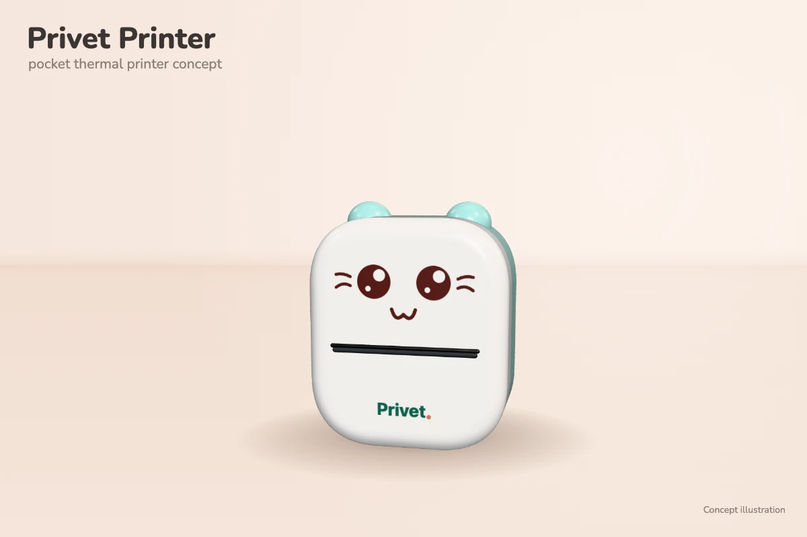

# Privet thermal printer — protocol, connection and printed cards

The native iOS app prints learning cards on a cheap 57 mm Bluetooth LE thermal "cat" printer: a **word of the day** card, a **practice strip** for a lesson and a **progress receipt**. It is the third Bluetooth device next to the desk robot (`Privet-ESP32`) and the keychain Mini (`Privet-Mini`), and it can be connected at the same time as either. There is no firmware to install: the app speaks the printer's own protocol. Website behavior is unchanged; printing exists only in the native app on a real iPhone.

Tested on an **SC03h** printer (advertised as `SC03h-438F`).

*Privet concept body for an SC03h-type printer, rendered from the app's 3D model. The app works with the printer as it is; the Privet body is a concept.* The same protocol is used by GB01, GB02, GB03, GT01, MX05, MX06, MX08, MX10, MX11 and YT01 printers; only the SC03h has been tried.

## Using it

1. Disconnect the printer from any other app or phone first. The printer takes **one connection at a time**: while another app or phone holds it, it cannot be found or will not connect, and the app says so.
2. **Settings → Printer → Connect**, then tap the printer in the list. The "printer found" card opens and plays its wake-up while it connects.
3. Print buttons appear only while the printer is connected:
   - a print icon on each revealed word in a lesson's vocabulary step (a word card for that word);
   - **Print a practice strip** on the end-of-lesson summary;
   - **Print today's progress receipt** on Profile;
   - **Print word of the day** and **Print a test page** on Settings → Printer.
4. Each opens a sheet with a preview of exactly what will print (the 1-bit image), the darkness setting and Print. While printing it shows rows sent / total and **Cancel printing**.

**Darkness:** Light (energy 8000), Normal (12000, the default) or Dark (20000), saved on the phone (`privet-demo-v1-printer-energy`) and sent with every print.

## Automatic reconnect

Works like the robot's ([companion-ble.md, *Automatic reconnect*](companion-ble.md#automatic-reconnect)).

- **Remembered printer:** each successful connection saves the printer's iOS device ID and name (`privet-demo-v1-printer-device`), separately from the remembered companion, so the robot's discovery never offers the printer and the reverse.
- **Looking for it:** while the app is in the foreground and that printer is not connected, it runs quiet scans on every screen and connects as soon as it sees it (`discover({target})`, state `quiet`, then `auto: true`). A look lasts 5 s; a new one starts within 4 s for 2 minutes after the printer was lost or the app came back to the foreground, then every 20 s.
- **Quiet:** no card, no scanning status and no errors (except a permission denial). Settings shows "*name* will reconnect by itself when it's nearby" while it waits. Connect or Print during a quiet look turns it into the visible scan, keeping what it found.
- **Off:** Disconnect turns automatic reconnection off (`privet-demo-v1-printer-auto-off`), across app restarts, until the next connection by hand.
- **Background:** going to the background ends a print job cleanly (lattice end sent) and disconnects, because iOS suspends the web view and the job would stall, and because it frees the printer for other apps. It reconnects by itself on return.
- While automatic reconnection is on, Privet takes the printer whenever it is switched on and the app is open, so other apps cannot. Disconnect in Privet first to use the printer from another app.

## Printer found card

`PrinterFoundCard` is the robot's "companion found" card for the printer, with a 3D model of it (`printerFigure` in `src/robotScene.ts`, shown through `Robot3D`; a printer icon without WebGL). The model is a Privet concept body for the SC03h shape (the same picture as at the top of this page): an upright rounded body, glossy white at the front and mint behind, meeting flush round the sides; two mint cat ears and vent holes on top; the paper slot across the front; its printed cat face (static, since there is no screen) and a "Privet." wordmark below the slot. On connect it hops, the LED on top lights and a paper strip printed "Privet" feeds out of the slot and droops over the front.

- **Home:** once Bluetooth was granted before (a companion or a printer connected once, `privet-demo-v1-ble-used`), home quietly looks for printers (`discover({offer: true})`) and offers the first one found. The remembered printer is skipped only while automatic reconnection is on, since it connects by itself (`offeredPrinter` in `src/foundCards.ts`); after Disconnect it is offered like any other. *Not now* or Disconnect ends the offers for the app session.
- **Settings → Printer:** the card opens when you tap a printer in the list.
- **One card at a time:** the companion card and the printer card never open together (`src/foundCards.ts`); the second waits until the first closes.

## Shared Bluetooth state

The printer has its own driver and transport (`src/printerDriver.ts`, `src/printerTransport.ts`), separate from the companion's, but the BLE plugin keeps some state process-wide. `src/bleShared.ts` owns it, created on first use in `src/bleNative.ts`:

- `BleClient.disableQueue()` and `initialize()` run once and are shared.
- iOS runs **one scan at a time** (a second `requestLEScan` stops the first) and `BleClient` keeps one scan listener. Each driver takes a **lease** on one shared native scan instead. The scan is unfiltered while any lease needs that (the printer, which does not reliably advertise its service), otherwise filtered by the leases' services. Each result goes only to the leases that accept it: the companion lease takes the Privet service UUID or a `Privet-` name, the printer lease takes printer names. Releasing a lease narrows or stops the scan; it never ends another driver's.
- `BleClient` keeps one Bluetooth-enabled listener; it is fanned out to any number of watchers.
- Each driver's `cleanup()` releases only its own lease, watch, notifications and device. It no longer calls the global `stopLEScan()` or `stopEnabledNotifications()`, so robot cleanup cannot kill a printer scan or job, and the reverse.

Bluetooth permission is still asked only after an explicit Connect or Print. `NSBluetoothAlwaysUsageDescription` in `ios/App/App/Info.plist` mentions the printer.

## Protocol (as tested)

| Item | Value |
| --- | --- |
| Name match | Unfiltered scan; the name, case-insensitively, starts with `SC03`, `GB0`, `GT01`, `MX0`, `MX1` or `YT01` (`PRINTER_NAME_PREFIXES`). `MXW01` uses a different protocol and is excluded. |
| Service | `0000ae30-0000-1000-8000-00805f9b34fb` |
| Write | `0000ae01-0000-1000-8000-00805f9b34fb`, **write without response** |
| Notify | `0000ae02-0000-1000-8000-00805f9b34fb`, status and flow control |

**Framing:** `51 78 | cmd | 00 | len_lo len_hi | data… | crc8(data) | FF`. CRC-8 with polynomial 0x07, init 0x00, no reflection and no final XOR, over the data bytes only. Test vectors: `A4 [33]` → `51 78 a4 00 01 00 33 99 ff`; lattice start → `… a1 ff`.

| cmd | Name | Data |
| --- | --- | --- |
| A3 | Get device state | `00` |
| A4 | Quality | `33` |
| BD | Speed | `20` (32) |
| AF | Energy (darkness) | uint16 LE (12000 = `E0 2E`) |
| BE | Apply energy | `01` |
| A9 | Update device | `00` |
| A6 | Lattice start | `AA 55 17 38 44 5F 5F 5F 44 38 2C` |
| A2 | Bitmap row | 48 bytes = one 384-px row |
| A1 | Feed paper | uint16 LE line count (80 after a print) |
| A6 | Lattice end | `AA 55 17 00 00 00 00 00 00 00 17` |

**Print sequence:** A3, A4, BD, AF, BE, A9, A6 (start), one A2 per image row, A1 (80), A6 (end), A3 (`printJob` in `src/printerProtocol.ts`).

**Image rows:** 384 px wide, 1 bit per pixel. Pixel `x` goes into byte `x >> 3`, bit `x & 7` (LSB first = leftmost pixel); 1 burns.

## Sending and flow control

- **One write at a time**, 10 ms apart (`PRINTER_TIMEOUTS.pace`). On iOS, `writeWithoutResponse` resolves as soon as it is handed to CoreBluetooth and never checks whether the buffer has room, so pacing is what keeps writes from being dropped.
- **Two rows per write** (`ROWS_PER_WRITE`): consecutive A2 packets are joined into one write; every other packet goes on its own. The printer parses a byte stream, so the bytes are identical. Set it to 1 if a print shows missing lines or garbled stripes; try 3 for more speed. Writes larger than the link's maximum (MTU − 3) are split by the driver.
- **Flow control:** the printer notifies `51 78 AE 00 01 00 10 70 FF` when its buffer is full and `51 78 AE 00 01 00 00 00 FF` when it can take more (byte 6: `0x10` pause, `0x00` resume). A pause holds sending until resume; with no resume within 8 s the job ends with "The printer stopped responding".
- **Cancel or leaving the app:** sending stops before the next packet and, if still connected, A6 (end) is sent so the printer does not wait for more rows. A dropped link stops sending with no further writes.
- **Progress:** rows sent / total, updated every 4 rows.
- **Busy printer:** a connection that fails or times out, or a scan that finds nothing, says "If another app or phone is connected to the printer, disconnect it there, then try again."

## The printed cards

Content (`src/printContent.ts`) is built only from the existing lessons, reviews and statistics; no new Russian is written for printing. Drawing (`src/printRender.ts`) uses an offscreen 384-px canvas on white, with text at 16 px or more because thermal paper blurs thin strokes. Text and line art use a hard threshold at 140/255; grey areas (the receipt's XP bars, the word to trace, the test page's gradient) are Floyd–Steinberg dithered (`ditherRegions`). Every card starts with the robot logo and "Privet".

- **Stress marks** are drawn by hand: the U+0301 accent is stripped from the text and stroked above its vowel (`fillStressed`). Real combining accents landed beside the vowel in Chromium; the drawn accent sits correctly in Chromium and in iOS Simulator Safari.
- **Word of the day:** a learned word (one with a review item), picked by the date and preferring weak or due words; the first lesson's words before anything is learned. It shows an inverted "СЛОВО ДНЯ · WORD OF THE DAY" banner, a line icon per lesson, the word with its stress, the transliteration, the meaning and, when the lesson has one, an example sentence that uses it (another line of the same lesson with its English), then a cut line. A vocabulary card's print icon prints the same card for that word. There is no grammar line (gender/plural is not in the lesson data yet) and no QR code.
- **Practice strip:** three fill-in-the-blank lines, each with three tick-box options. Blanks come from the lesson's multi-word lines; wrong options are other words of the lesson, then of the course, never a word of the same line, and names (such as Анна) are never blanked or offered. A lesson with too few lines also gets "____ (meaning)" items. Then **trace & write**: the lesson's typed-exercise word in dithered grey to write over (without stress marks), with a line to write it again. The answers are printed upside down below a cut line.
- **Progress receipt:** like a shop receipt: the date and time, the streak in days with Mon–Sun boxes, then dotted-leader lines for new words (from lessons finished today), reviewed (today's review answers), accuracy (first-try results from today's lessons and reviews together) and XP today. Then today's words with 1–3 stars from their review box (0–1, 2–3, 4–5), an XP bar chart of the last 7 days (dithered bars, today solid), total XP and "Молодец! До завтра!". Minutes studied, robot nods and levels are not tracked, so they are not shown.
- **Test page:** text with stress marks, a dithered gradient and line weights, for checking a new printer and the darkness.

## Source

| Source | Responsibility |
| --- | --- |
| `src/printerProtocol.ts` | UUIDs, name matching, `crc8`, `packet()`, `packRows()` (threshold/dither, LSB first), `printJob()`, flow-control decoding |
| `src/printerTransport.ts` | Scan, connect, quiet discovery and offers, paced batched sending, flow control, cancel, background and the busy hint |
| `src/printerDriver.ts` | Plugin adapter: its own scan lease, disconnect listener, notifications and MTU-sized writes without response |
| `src/bleShared.ts`, `src/bleNative.ts` | The plugin's shared state: one initialization, the shared scan with leases, the Bluetooth-enabled fan-out |
| `src/usePrinter.ts` | App-wide printer hook: remembered printer, darkness, auto-reconnect loop, home offers, print-when-connected |
| `src/printContent.ts`, `src/printRender.ts` | Card content from lessons/reviews/stats; canvas drawing, hand-drawn stress marks and packing |
| `src/PrinterScreen.tsx` | Settings → Printer, the print sheet with preview and progress, the settings button |
| `src/PrinterFoundCard.tsx`, `src/foundCards.ts` | "Printer found" card, which printer to offer, one found card at a time |
| `src/robotScene.ts` (`printerFigure`), `src/Robot3D.tsx` | 3D printer model and its connect animation |
| `src/printerProtocol.test.ts`, `printerTransport.test.ts`, `bleShared.test.ts`, `printContent.test.ts`, `printRender.test.ts`, `foundCards.test.ts` | Unit tests with a fake driver and clock; no real printer or canvas |

## Verification

**Automated (`npm test`):** both CRC test vectors, packet framing, LSB-first bit order, 48-byte rows, threshold and dithering, the exact print order and energy encoding, name matching (MXW01 excluded); pacing, one write at a time, two rows per write with identical bytes, pause/resume and the stall limit, cancel and background sending the lattice end, a dropped link stopping with no end packet, the busy hint, quiet discovery, home offers and auto-reconnect; the shared scan (robot cleanup never ending a printer scan, and the reverse; each lease receiving only its own devices) and the enabled-state fan-out; card content for all eight lessons; stress-mark placement; which printer home offers. `npm run test:interactions` checks that print buttons stay hidden while no printer is connected.

**On the real SC03h (reported by the project owner):** connecting, printing, the progress receipt, the print speed with two rows per write, automatic reconnect after the printer is switched off and on, the "printer found" card on home and in settings, and printing while the robot is connected at the same time.

**Still to check on hardware:** other printer models (GB01–GB03, GT01, MX05–MX11, YT01).
