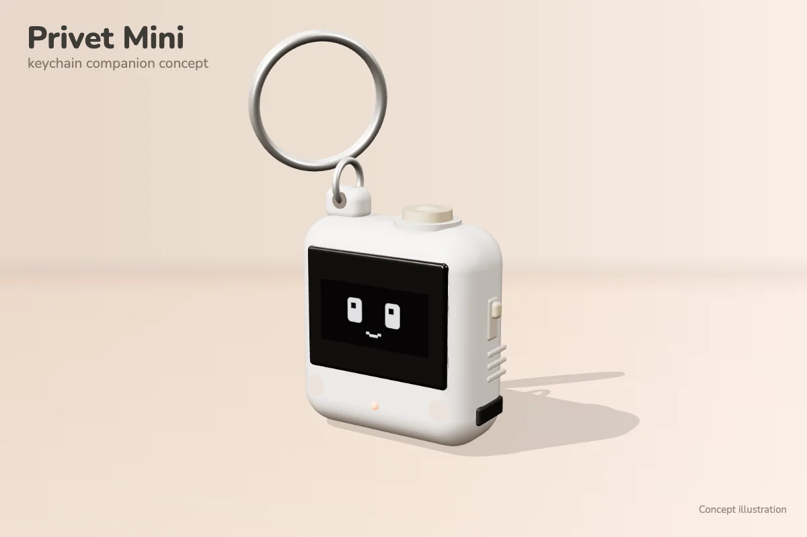

# PrivetMini_v0.5: the keychain companion

A small keychain version of the Privet companion: a Seeed XIAO ESP32-S3 and a 0.96" SSD1306 OLED, with no servos or
sound. It speaks the same BLE protocol as the desk robot ([PrivetBLE_S3_v5](../PrivetBLE_S3_v5/README.md)): the same
service and characteristic UUIDs, reactions 1–9, 11 NOD and 12 ON_FIRE, and the same negotiated learning cards
(`LearningCards.h` and `LearningLayout.h` are copies of the desk robot's). It advertises as **Privet-Mini**; the app
uses that name to show the keychain figure in its "companion found" card (see
[docs/companion-ble.md](../../docs/companion-ble.md)). Control code 13 `SET_VOLUME` is answered "unsupported", and the
capability reply leaves the sound bit off, so the app hides its volume setting.

The picture is a concept render. The firmware so far drives the screen and BLE only; see *Not in the firmware yet*.

## Setup

- Arduino IDE, **esp32 by Espressif** core 3.x, board **XIAO_ESP32S3**.
- Library: **U8g2** (same as the desk robot).
- Serial Monitor: 115200 baud. Start-up prints the I2C devices found, then every BLE command and ACK.

## Wiring

| Part | Pin | XIAO ESP32-S3 |
| --- | --- | --- |
| OLED (SSD1306, I2C) | VCC | 3V3 |
| | GND | GND |
| | SDA | D4 (GPIO5) |
| | SCL | D5 (GPIO6) |
| Status LED | built-in orange user LED | GPIO21 (LOW = on) |

The sketch looks for the screen at 0x3C or 0x3D. If the picture is garbled or shifted, the module probably has an
SH1106 chip: change `U8G2_SSD1306_128X64_NONAME_F_HW_I2C` to the SH1106 variant in the sketch. BLE still runs without
a screen. The LED is on while a phone is connected.

## Faces

The Mini has its own face set in `MiniFaces.h`, not the desk robot's: sleeping plus the eleven reactions, all in one
style. The eyes are 16 × 20 px rounded rectangles, 36 px apart, each with a small shine. Lines are 2 px. Extras
(Zzz, sparkles, thought dots, sound waves, the bulb, the flame) stay in the top band or at the sides. There is no
corner connection dot; the LED shows the connection.

| Face | When | What it does |
| --- | --- | --- |
| Sleeping | not connected, or connected before the app's first reaction | Closed "‿" eyes breathe; Zzz float up |
| CONNECTED (9) | the app's first reaction | Eyes pop open with a small overshoot, smile, sparkles |
| IDLE (4) | resting | Blinks; glances aside for the first minute after a command |
| HAPPY (1) | correct answer | "^ ^" eyes and an open smile, a little double bounce |
| ENCOURAGE (2) | wrong answer | Sad eyes and a tear, then a hopeful smile |
| NOD (11) | correct match pair | Happy eyes; the face dips once |
| ON_FIRE (12) | first-try combo | Flame and the combo ("x3") above bouncing happy eyes |
| CELEBRATE (3) | lesson complete | Bouncing joy, twinkling sparkles, confetti at the sides |
| STREAK (8) | streak day | Pulsing star eyes |
| THINKING (6) | question open | Eyes look up and to the right; thought dots fill in |
| LISTENING (5) | word playing | Wide eyes, small "o", sound waves on both sides |
| HINT (7) | hint | Flashing light bulb |

Durations match the desk robot (and the app's card timings). `MiniFaces.h` draws pixel by pixel, so the app's 3D
figure can show exactly the same sleeping, CONNECTED and IDLE faces from `src/miniFaces.ts`. When you change those
three faces, change both; `npm test` compiles `MiniFaces.h` on the host (`scripts/test-mini-faces.cpp`), checks that
every reaction draws a face for its whole duration, and compares the three faces with the app pixel for pixel.

## Not in the firmware yet

The concept has parts the sketch does not use yet:

- **Button**: the tact button on top is not read. Wire it to D0–D3 or D8–D10 (these can wake the chip from deep sleep).
- **MPU6050**: not read. It can share the OLED's I2C bus (address 0x68); the desk robot's `MotionSense.h` would fit.
- **Battery**: the XIAO charges the LiPo but cannot measure it; a resistor divider to an analog pin would be needed.
- **Power saving**: the sketch runs at full CPU speed, advertises at the default rate and redraws the whole screen
  about 30 times a second at full brightness, with no sleep. Expect a few hours on 300 mAh; measure it before relying
  on it.

No hardware results for the faces or cards on the Mini have been reported yet.
