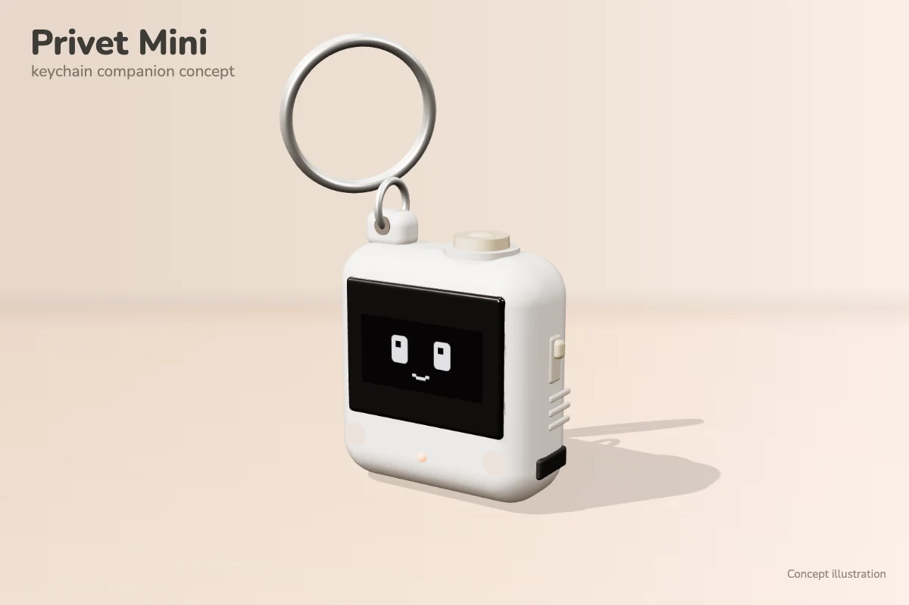

# PrivetMini_v0.6: the keychain companion with motion, buttons and pocket words

A small keychain version of the Privet companion: a Seeed XIAO ESP32-S3, a 0.96" SSD1306 OLED, an MPU6050 motion sensor
and two buttons, with no servos or sound. It speaks the same BLE protocol as the desk robot
([PrivetBLE_S3_v5](../PrivetBLE_S3_v5/README.md)): the same service and characteristic UUIDs, reactions 1–9, 11 NOD and
12 ON_FIRE, and the same negotiated learning cards (`LearningCards.h` and `LearningLayout.h` are copies of the desk
robot's). It advertises as **Privet-Mini**; the app uses that name to show the keychain figure in its "companion found"
card (see [docs/companion-ble.md](../../docs/companion-ble.md)). Control code 13 `SET_VOLUME` is answered "unsupported",
and the capability reply leaves the sound bit off, so the app hides its volume setting.

New in v0.6 (v0.5 is the screen-and-BLE-only version), all on the Mini itself. The app is never told, and the BLE
protocol is unchanged:

- **Living eyes:** the IDLE eyes roll towards the low side whenever you tilt it, in your hand too.
- **Motion play:** shake it properly and it gets dizzy; toss it and it goes "whee"; face down it switches its screen
  off; turned back up it plays peekaboo.
- **Pocket words:** it keeps the last 30 Russian words the app showed it, with their meanings, so you can flip through
  them with the right button, without the phone.
- **Buttons:** a pat (giggle), a hug, a status screen and a reconnect.



The picture is a concept render.

## Setup

- Arduino IDE, **esp32 by Espressif** core 3.x, board **XIAO_ESP32S3**, USB CDC On Boot **Enabled**, partition scheme
  **Default with spiffs (3MB APP/1.5MB SPIFFS)** (the board's defaults).
- Library: **U8g2** (same as the desk robot). Nothing else: the MPU6050 is read with raw register reads over `Wire`,
  and the words and the learned orientation are kept with the core's built-in `Preferences`.
- Serial Monitor: 115200 baud. Start-up prints the I2C devices, the MPU6050, the saved words and the battery status,
  then every BLE command and ACK and every motion, button and word event.

## Wiring

| Part | Pin | XIAO ESP32-S3 |
| --- | --- | --- |
| OLED (SSD1306, I2C 0x3C) | VCC / GND | 3V3 / GND |
| | SDA / SCL | D4 (GPIO5) / D5 (GPIO6) |
| MPU6050 (I2C 0x68, AD0 open) | VCC / GND | 3V3 / GND |
| | SDA / SCL | same bus: D4 (GPIO5) / D5 (GPIO6) |
| | INT | D8 (GPIO7) |
| Left button | one leg to the pin, the other to GND | D7 (GPIO44), internal pull-up |
| Right button | one leg to the pin, the other to GND | D9 (GPIO8), internal pull-up |
| Battery divider (not fitted yet) | battery + through the divider | D0 (GPIO1) |
| Status LED | built-in orange user LED | GPIO21 (LOW = on) |

The MPU6050 module must lie **flat on the same side of the board as the screen** (as on the prototype board). Then
its Z axis is the screen's normal, and the Mini only has to learn which way is up (see *Motion*).

The OLED and the MPU6050 share one I2C bus at 400 kHz. The sketch finds the screen at 0x3C or 0x3D and the MPU6050 at
0x68 or 0x69. If the picture is garbled or shifted, the module probably has an SH1106 chip: change
`U8G2_SSD1306_128X64_NONAME_F_HW_I2C` to the SH1106 variant in the sketch. BLE still runs without a screen, and
everything except motion works without the MPU6050. The LED is on while a phone is connected.

**Battery.** `BATTERY_DIVIDER_FITTED` is `false`, so the battery is not read and the status screen leaves it out. Once
a divider from the battery + to D0 is fitted (two equal resistors, e.g. 2 × 220 kΩ, for `BATTERY_DIVIDER = 2`), set it
to `true`. The percentage comes from a typical LiPo voltage curve; while USB charges the cell it reads high.

## What it does

"Awake" means after the app's first reaction (CONNECTED); "asleep" is the sleeping face (no phone, or connected before
that first reaction). Awake, motion and the left button react only over a resting face (IDLE or THINKING), never
during an answer reaction or while a word plays, and any app command ends a local face at once.

| You do | Awake | Asleep |
| --- | --- | --- |
| Tilt it (in IDLE) | The eyes roll down the slope, springy; lying on its back they look up at you | — |
| Shake it (about 0.6 s) | **Dizzy**: spiral eyes spin and slow down, 2.5 s | Drowsy **stir** |
| Toss it up a little and catch it | **Whee**: wide eyes and sparkles, 2 s | Drowsy stir |
| Lay it face down, still (0.7 s) | Screen off ("do not disturb"; saves power) | Screen off |
| Turn it face up again | Screen on, **peekaboo**, 1.4 s | Screen on |
| Right button | **Pocket words** (see below) | Pocket words |
| Left button | **Giggle** (a pat), 1.2 s; in pocket words: close | Drowsy stir; in pocket words: close |
| Hold left | **Hug**: happy squint and floating hearts, while held | Drowsy stir |
| Hold right | Status: "Privet Mini", connected or "waiting for app", words saved, battery once fitted, 3 s | Same |
| Hold both 2 s | "Reconnect...": drops the phone (tap Connect in the app; it does not reconnect by itself) | Restarts advertising |

The drowsy stir (heavy half-lids, one slow blink, back to sleep) comes at most once every 4 s. A hold starts at
0.6 s; a press released sooner is a short press. Once both buttons are down together, neither counts as a short press,
and a running hug ends.

### Pocket words

The app already sends the Mini a Russian word with its meaning in two cases: a word you tap while discovering
vocabulary (a DISCOVERY card) and the answer after you get it right (an ANSWER card). The Mini keeps the last 30 of these
in flash, newest first, without duplicates. It never keeps prompts, hints or status cards, and it never makes up
content.

- **Right:** shows the newest saved word (Russian), with "3/12" in the corner. **Right again:** adds its meaning
  underneath. **Right again:** the next word.
- **Shake** while a word is shown: a random word.
- **Left:** closes. If you saw five or more meanings, the Mini shows a **proud** face (star eyes) for 2 s.
- It closes by itself after 30 s untouched, and at once on any app command.
- With no words yet it says "No words yet / Learn in the app".

So it can never give an answer away, pocket words don't open while a lesson question may be open: the app's last
command was THINKING, HINT, LISTENING, NOD or ENCOURAGE (a wrong answer keeps the question open until the retry), or a
question or hint card is on screen. Asleep (no lesson running) they always open.

### Motion

Detection is in `MiniMotion.h`, written for a keychain rather than copied from the desk robot (whose rules wait for it
to rest on a table, and fire on small movements of a light object):

- **Look:** sideways tilts under about 5° are ignored; about 38° is the full look (10 px). Leaning back more than about
  20° turns the eyes up, fully when lying on its back (8 px). The eyes follow with a small spring and keep blinking.
- **Shake:** six jolts over 1 g beyond gravity (`SHAKE_G`; about a 1 cm shake at 5 Hz), each roughly opposite to the
  last and within 0.35 s of it, then a 2 s pause. Swinging on the key ring, walking, a single flick or a small wobble
  don't count.
- **Toss:** under 0.35 g (free fall) for 80 ms, not in the middle of a shake. Dropping it counts too.
- **Face down / up:** the screen facing the floor for 0.7 s while held fairly still (so moving it around never turns
  the screen off); face up again for 0.3 s.

**Which way is up.** The Mini learns it the first time it is held upright (screen facing you, within about 20° of
vertical) and still for half a second, and saves it in flash. After that it works from the start even if you power it
on lying flat. During the first 10 s after each power-on, holding it upright and still relearns it. So if the eyes
look sideways while it stands straight, power it on, hold it straight for a second, and it is fixed.

**Screen sign.** `MOTION_SCREEN_SIGN = -1` because the prototype's SY-104 module has the chip on its underside, so the
sensor's +Z points into the board. With the wrong sign, left and right are swapped and holding it screen-up (or lying
on its back) turns the screen off; use +1 for a module whose chip faces you.

**How it is read.** A small FreeRTOS task samples the buttons every 10 ms and the accelerometer every 20 ms (50 Hz),
also while `loop()` sends a frame to the screen. It only queues events. `loop()` prints them and does all the drawing
and flash writes, and the BLE callbacks still only store state.

**INT pin.** The MPU6050's motion interrupt is set up on D8 (active high, latched until the next sensor read; threshold
`MPU_MOTION_THRESHOLD` × 2 mg). It is only logged for now, so it can later wake the chip from sleep.

## Testing on the breadboard

Open the Serial Monitor at 115200 baud. The first time, power it on and hold it upright, screen facing you, still for
a second. Expect:

```
[WORDS] 0 pocket words saved
[I2C] Devices: 0x3C 0x68
[OLED] OK at 0x3C
[MOTION] MPU6050 at 0x68 (WHO_AM_I 0x68).
[MOTION] No saved "up" yet: hold it upright (screen facing you) and still for a moment.
[BATTERY] divider not fitted (BATTERY_DIVIDER_FITTED = false)
[BLE] Advertising as Privet-Mini. Connect from the app.
[MOTION] learned "up" (0.02, 0.99, 0.00) and saved it
```

The numbers depend on how the chip sits on its module. Some MPU6050 clones report another WHO_AM_I; that is fine as
long as motion works.

**Without the app:**
1. Lay it face down: `[MOTION] face down: screen off`. Turn it up: `face up: screen on` (the sleeping face returns;
   peekaboo plays only when awake).
2. Shake it for about half a second: `[MOTION] shaken` and `asleep: stir`. A small wiggle or swinging it on its ring
   prints nothing. Walk around holding it like a phone: the screen must stay on.
3. Toss it up a few centimetres and catch it: `[MOTION] tossed` and a stir (one per 4 s).
4. Right button: `[WORDS] none saved yet` and "No words yet". Right again closes.
5. Hold right: the status screen. Hold both 2 s: `[BUTTON] both held: restarting BLE` and "Reconnect...".
6. The first motion should also print `[MOTION] INT on D8 went high: the motion interrupt is wired`. If it never
   does, check the INT wire.

**With the app (connect, wait for the CONNECTED face to finish):**
1. Tilt it right, left, then lay it on its back: `[MOTION] tilted right: eyes look right`, `tilted left: eyes look
   left`, `lying back: eyes look up`. The eyes must go to the lower side; if they go up the slope, see *Motion*.
2. Shake it: `[MOTION] shaken: dizzy`. Toss and catch it: `[MOTION] tossed: whee`.
3. Left button: `[BUTTON] pat: giggle`. Hold left: `[BUTTON] hug` (hearts) until you let go.
4. Do a lesson: each discovered word and each correct answer that has a meaning prints
   `[WORDS] kept "..." = "..." (N saved)`.
5. On the home screen (or after the lesson), right: the newest word; right: its meaning; right: the next word; shake:
   a random word. After five meanings, left closes with the proud face.
6. During a question, right prints `[WORDS] not now: a question, hint or reaction is on`, and motion and the left
   button print `(ignored: a reaction is playing)` while an answer reaction plays.
7. Start any local face or the words, then trigger an app reaction: the app's face replaces it at once.

## Faces

The Mini has its own face set in `MiniFaces.h`, not the desk robot's: sleeping, the eleven app reactions and the local
faces above, all in one style. The eyes are 16 × 20 px rounded rectangles, 36 px apart, each with a small shine. Lines
are 2 px. Extras (Zzz, sparkles, thought dots, sound waves, the bulb, the flame, hearts) stay in the top band or at the
sides. There is no corner connection dot; the LED shows the connection.

| Face | When | What it does |
| --- | --- | --- |
| Sleeping | not connected, or connected before the app's first reaction | Closed "‿" eyes breathe; Zzz float up |
| CONNECTED (9) | the app's first reaction | Eyes pop open with a small overshoot, smile, sparkles |
| IDLE (4) | resting | Blinks; glances aside for the first minute after a command; follows tilts |
| HAPPY (1) | correct answer | "^ ^" eyes and an open smile, a little double bounce |
| ENCOURAGE (2) | wrong answer | Sad eyes and a tear, then a hopeful smile |
| NOD (11) | correct match pair | Happy eyes; the face dips once |
| ON_FIRE (12) | first-try combo | Flame and the combo ("x3") above bouncing happy eyes |
| CELEBRATE (3) | lesson complete | Bouncing joy, twinkling sparkles, confetti at the sides |
| STREAK (8) | streak day | Pulsing star eyes |
| THINKING (6) | question open | Eyes look up and to the right; thought dots fill in |
| LISTENING (5) | word playing | Wide eyes, small "o", sound waves on both sides |
| HINT (7) | hint | Flashing light bulb |

Durations match the desk robot (and the app's card timings). `MiniFaces.h` draws pixel by pixel, so the app's 3D
figure can show exactly the same sleeping, CONNECTED and IDLE faces from `src/miniFaces.ts`. When you change those
three faces, change both.

`npm test` compiles this folder's headers on the host:
- `scripts/test-mini-faces.cpp`: every reaction, local face and tilted look draws a face for its whole duration, and
  the three faces match the app pixel for pixel.
- `scripts/test-mini-motion.cpp`: synthetic handling (learning up, tilts, swinging, walking, flicks, a wobble, a
  moderate and a hard shake, a toss, face down, moving upside down).
- `scripts/test-mini-buttons.cpp`: bounce, short presses, holds and both held.
- `scripts/test-mini-words.cpp`: which cards are kept, order, duplicates and a full deck.

## Not in the firmware yet

- **Sleep**: the sketch runs at full CPU speed, advertises at the default rate and redraws the whole screen about 30
  times a second at full brightness (except face down, when the panel is off). Expect a few hours on 300 mAh; measure
  it before relying on it. The MPU6050's INT on D8 (GPIO7) and the right button on D9 (GPIO8) can wake the chip from
  deep sleep. The left button on D7 (GPIO44) is not an RTC pin, so it can wake it only from light sleep.
- **Battery**: the code is there; the divider is not fitted yet (see Wiring).
- **Pocket words in the app**: the words you review on the Mini aren't counted in the app's statistics.

No hardware results for the faces, cards, motion, buttons or pocket words on the Mini have been reported yet.
