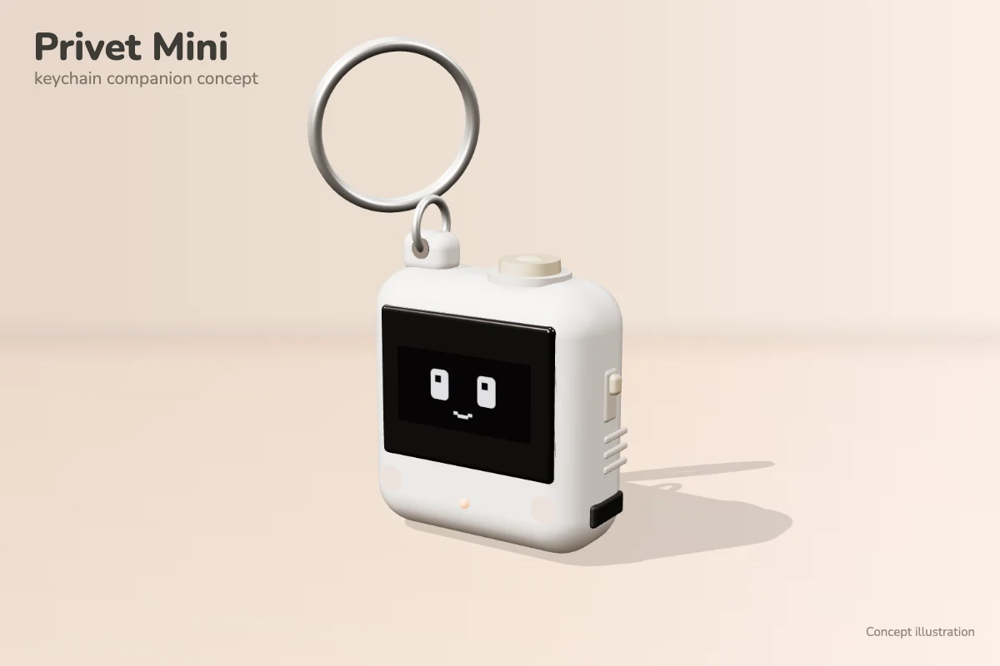

# PrivetMini_v0.8: the keychain companion with sound

A small keychain version of the Privet companion: a Seeed XIAO ESP32-S3, a 0.96" SSD1306 OLED, an MPU6050 motion sensor,
two buttons and a passive buzzer, with no servos. It speaks the same BLE protocol as the desk robot
([PrivetBLE_S3_v5](../PrivetBLE_S3_v5/README.md)): the same service and characteristic UUIDs, reactions 1–9, 11 NOD and
12 ON_FIRE, control code 13 SET_VOLUME, and the same negotiated learning cards (`LearningCards.h` and `LearningLayout.h`
are copies of the desk robot's). It advertises as **Privet-Mini**; the app uses that name to show the keychain figure in
its "companion found" card (see [docs/companion-ble.md](../../docs/companion-ble.md)).

New in v0.8, compared with [PrivetMini_v0.7](../PrivetMini_v0.7/README.md):

- **Sound** on a passive buzzer on D10: short tones for the app's reactions, the local faces and review answers (see
  *Sound*).
- **Volume** in two places: **Sound** in the Mini's menu, and the app's **Robot sound** setting, which now appears for
  the Mini too (capability bit 16).

Kept from v0.7:

- **Pocket review deck:** on each connection the app copies today's due review words onto the Mini, which quizzes you
  off the phone; your answers go back into the app's review schedule on the next connection (see *Pocket review
  deck* below).
- **A menu** on the right button: Review, Flashcards, Status and (new) Sound, with every screen naming what the two
  buttons do (see *Menu*).

Kept from v0.6:

- **Living eyes:** the IDLE eyes roll towards the low side whenever you tilt it, in your hand too.
- **Motion play:** shake it properly and it gets dizzy; toss it and it goes "whee".
- **Flashcards** (v0.6's pocket words): the last 30 Russian words the app showed it, with their meanings, to flip
  through without the phone.
- **Buttons on the face:** a pat (giggle) and a hug.
- **Power:** the screen dims after a minute of no use; after 5 minutes untouched with no phone it goes to deep sleep,
  and the right button wakes it.



The picture is a concept render.

## Setup

- Arduino IDE, **esp32 by Espressif** core 3.x, board **XIAO_ESP32S3**, USB CDC On Boot **Enabled**, partition scheme
  **Default with spiffs (3MB APP/1.5MB SPIFFS)** (the board's defaults).
- Library: **U8g2** (same as the desk robot). Nothing else: the MPU6050 is read with raw register reads over `Wire`,
  the buzzer is driven with the core's LEDC PWM, and the words, the learned orientation and the sound level are kept
  with the core's built-in `Preferences`.
- Serial Monitor: 115200 baud. Start-up prints the I2C devices, the MPU6050, the saved words, the review deck, the
  battery status and the sound level, then every BLE command and ACK and every motion, button, word, deck and sound
  event.

## Wiring

| Part | Pin | XIAO ESP32-S3 |
| --- | --- | --- |
| OLED (SSD1306, I2C 0x3C) | VCC / GND | 3V3 / GND |
| | SDA / SCL | D4 (GPIO5) / D5 (GPIO6) |
| MPU6050 (I2C 0x68, AD0 open) | VCC / GND | 3V3 / GND |
| | SDA / SCL | same bus: D4 (GPIO5) / D5 (GPIO6) |
| | INT | D8 (GPIO7) |
| Left button | one leg to the pin, the other to GND | D7 (GPIO44), internal pull-up |
| Right button | one leg to the pin, the other to GND | D9 (GPIO8), internal pull-up |
| Passive buzzer | + to the pin, − to GND | D10 (GPIO9) |
| Battery divider (not fitted yet) | battery + through the divider | D0 (GPIO1) |
| Status LED | built-in orange user LED | GPIO21 (LOW = on) |

The MPU6050 module must lie **flat on the same side of the board as the screen** (as on the prototype board). Then
its Z axis is the screen's normal, and the Mini only has to learn which way is up (see *Motion*).

The OLED and the MPU6050 share one I2C bus at 400 kHz. The sketch finds the screen at 0x3C or 0x3D and the MPU6050 at
0x68 or 0x69. If the picture is garbled or shifted, the module probably has an SH1106 chip: change
`U8G2_SSD1306_128X64_NONAME_F_HW_I2C` to the SH1106 variant in the sketch. BLE still runs without a screen, and
everything except motion works without the MPU6050. The LED is on while a phone is connected.

**Buzzer.** It must be a **passive** buzzer (no built-in oscillator; it beeps only when driven with a tone, and on a
plain 3.3 V it just clicks): the firmware plays different pitches and glides on it. An active buzzer would only buzz
at its own pitch. A small piezo can sit directly on the pin. A magnetic (coil) buzzer draws more than a pin should
supply: drive it through an NPN transistor (base through 1 kΩ from D10, buzzer between 3V3 and the collector, a diode
across the buzzer). If no buzzer is fitted, nothing breaks: the PWM just runs into nothing.

**Battery.** `BATTERY_DIVIDER_FITTED` is `false`, so the battery is not read and the status screen leaves it out. Once
a divider from the battery + to D0 is fitted (two equal resistors, e.g. 2 × 220 kΩ, for `BATTERY_DIVIDER = 2`), set it
to `true`. The percentage comes from a typical LiPo voltage curve; while USB charges the cell it reads high.

## What it does

"Awake" means after the app's first reaction (CONNECTED); "asleep" is the sleeping face (no phone, or connected before
that first reaction). Awake, motion and the left button react only over a resting face (IDLE or THINKING), never
during an answer reaction or while a word plays, and any app command ends a local face at once.

| You do | Awake | Asleep |
| --- | --- | --- |
| Tilt it (in IDLE) | The eyes roll down the slope, springy; lying on its back they look up at you | — |
| Shake it (about 0.6 s) | **Dizzy**: spiral eyes spin and slow down, 2.5 s | Drowsy **stir** |
| Toss it up a little and catch it | **Whee**: wide eyes and sparkles, 2 s | Drowsy stir |
| Right button | The **menu** (see below) | The menu |
| Left button | **Giggle** (a pat), 1.2 s | Drowsy stir |
| Hold left | **Hug**: happy squint and floating hearts, while held | Drowsy stir |

The drowsy stir (heavy half-lids, one slow blink, back to sleep) comes at most once every 4 s. A hold starts at
0.6 s; a press released sooner is a short press.

### Menu

Right on the face opens a menu of five rows: **Review** ("7 due", "done" or "none"), **Flashcards** (how many),
**Status**, **Sound** (the level, e.g. "Medium") and **Exit** (back to the face). It starts on Review when cards are due, otherwise on Flashcards. Every screen has the same frame, so the
buttons always read the same way:

- a **footer** naming both buttons, left on the left and right on the right ("next / open", "back / flip",
  "didn't / knew it");
- **right moves forward** (open, flip, next, knew it); **left goes back or says no** (next row in the menu, back to
  the menu, didn't); **hold left** goes straight back to the face from anywhere;
- the **header** tells the two modes apart: **REVIEW** is a solid bar with a progress bar under it (it is scored),
  **FLASHCARDS** and **STATUS** are a light outline (nothing is scored).

The menu closes by itself after 10 s untouched, other screens after 30 s, and everything closes at once on an app
command. Waking from deep sleep with the right button opens the menu. So it can never give an answer away, the menu
doesn't open while a lesson question may be open: the app's last command was THINKING, HINT, LISTENING, NOD or
ENCOURAGE (a wrong answer keeps the question open until the retry), or a question or hint card is on screen. Asleep
(no lesson running) it always opens.

The screens are drawn by `MiniScreens.h` with U8g2's C API, so `scripts/render-mini-screens.cpp` (now pointed at v0.8) can draw every one
of them on a computer, with the real fonts, for previews (build line at the top of that file).

| Screen | Left | Right |
| --- | --- | --- |
| Menu | next row | open it (Exit: back to the face) |
| Review card (front) | quit to the menu (the cards stay) | flip |
| Review card (flipped) | didn't | knew it |
| Review done ("Well done! 5 of 7 known") | ok | ok (then the proud face) |
| Flashcard | back to the menu | flip, then next |
| Status | back | reconnect |
| Sound | back | one level louder (Max → Off), with a chirp at the new level |
| Nothing to review / no flashcards yet | back | — |

### Sound

The buzzer plays short synthesized tones (`MiniSound.h`): steady notes, glides and rests, between about 600 Hz and
3 kHz, where a small buzzer is loud. They are cousins of the desk robot's sound files, not copies.

| Sound | When |
| --- | --- |
| Wake chirp, rising | CONNECTED (the app's first reaction) |
| Two rising notes | HAPPY (correct answer); "knew it" in a review |
| A soft "aww" with a hopeful lift (soft) | ENCOURAGE (wrong answer); "didn't" in a review |
| Four-note arpeggio | CELEBRATE (lesson complete); a finished review round |
| "A-ha!" | HINT |
| Fanfare | STREAK |
| A tiny tick (soft) | NOD (each match pair) |
| A warble and a chime | ON_FIRE |
| Three quick rising chirps | Giggle (left button) |
| A cat-like "mrrr" purr (soft), looping for as long as you hold | Hug (hold left) |
| Falling wobble | Dizzy (shaken) |
| A long rising glide | Whee (tossed) |
| A drowsy "mm-hm?" (soft) | Stir (poked, shaken or tossed while asleep) |
| One short tick (soft) | Flashcards: flipping to the meaning |
| Three quick falling ticks, a "shuffle" (soft) | Flashcards: shaking for a random word |

- **Silent on purpose:** LISTENING stops any sound at once, because the phone is speaking a Russian word; THINKING and
  IDLE are silent (a sound already playing finishes). Asleep, only the stir makes a sound, and falling asleep (the
  phone going away) stops a sound. Moving through the menu, "next" and "back" make no sound; in flashcards only the flip and the shuffle do.
- **The purr:** a buzzer has no real rumble, so it is a low tone (about 600–720 Hz) chopped 20 ms on, 10 ms off; the
  flutter is the "rrr". A short "m" glide, a slightly higher in-breath, a pause, a lower out-breath, a longer pause:
  0.9 s, over and over until you let go (like the desk robot's purr while its head is held). It stops when you let go,
  when an app reaction comes in (that reaction's sound plays instead) or when it falls asleep.
- **One at a time:** a new sound replaces the one playing.
- **Levels:** Off, Quiet, Medium, Loud and Max, the same five as the app. Loudness is the PWM duty (`LEVEL_DUTY` in
  `MiniSound.h`: 4, 24, 110 and 512 of 1024; 512 = 50 %, a piezo's loudest). These are a first guess: if two levels
  sound the same on your buzzer, change the numbers there. "Soft" sounds play one level quieter (but never silent).
  The default is Medium.
- **Setting the level:** **Sound** in the menu shows the level and a meter; right steps it up and plays the happy
  chirp at the new level (Max wraps round to Off). Or in the app: **Robot sound** in the companion settings (the Mini
  now advertises capability bit 16, so the app shows it), which also plays the chirp. The level is kept in flash.
  **The app's level wins on the next connection:** the app sends its saved level every time it connects, so a level
  changed only on the Mini lasts until then. Set it in the app to make it stick.
- **How it plays:** the input task, which already wakes every 10 ms for the buttons, steps the sound and sets the PWM
  (LEDC, 10-bit duty) only when the tone changes, so sounds keep their timing while `loop()` sends a frame. `loop()`
  only posts which sound to play. The buzzer is silenced before deep sleep.

### Pocket review deck

The Mini advertises capability bit 32, so the app syncs with it once per connection, in the background (lesson
reactions always go first; see [docs/companion-ble.md](../../docs/companion-ble.md), *Pocket review deck*):

1. It sets the Mini's clock (the clock keeps running through deep sleep, not through a power loss).
2. It reads your answers to the deck the Mini holds and saves them to its review schedule, then tells the Mini to
   forget that deck.
3. It copies today's due review words, up to 20 (only words: sentences and exercises stay in the app).

Off the phone, **Review** in the menu:

- **The card:** words you're still learning show the Russian with "what does it mean?"; words you've known for a while
  show the English meaning with "say it in Russian". The header shows "3/7" and a progress bar.
- **Right** flips it: the Russian large with the meaning below. **Then right = knew it, left = didn't.** A short happy
  or gentle face, then the next card. Left before flipping quits to the menu (the cards stay for later).
- A missed word comes back once at the end; only your first answer counts.
- At the end: "Well done! 5 of 7 known"; either button then shows the proud face. The menu then says "done".
- With nothing to review it says so: "All done for now" (answers go to the app when you connect) or "Nothing to
  review" (today's words arrive when you connect).
- Each answer is saved to flash at once, with its day (or "unknown" if the clock was lost), and kept until the app
  has saved it.

In the app the home review card says how many of today's words are on your Mini too, and after a sync with answers
home says "Your Mini: 6 reviewed, 5 known. Nice work!". A Mini answer counts like a review in the schedule (in the log
as a `pocket` review), unless you reviewed that word in the app after the deck was copied (the app's review is newer).
For the streak, each day with Mini answers is a practice day; each card you knew gives 1 XP (less than an in-app
review, which is harder); no gems.

### Flashcards (pocket words)

The app already sends the Mini a Russian word with its meaning in two cases: a word you tap while discovering
vocabulary (a DISCOVERY card) and the answer after you get it right (an ANSWER card). The Mini keeps the last 30 of these
in flash, newest first, without duplicates: "Спасибо!", "спасибо" and "Спасибо." are one word (case,
punctuation, spaces and ё/е are ignored), kept with the newest spelling. Duplicates saved by an older build are
removed at start-up. It never keeps prompts, hints or status cards, and it never makes up content.

**Flashcards** in the menu shows them, newest first, with "12/23" in the header: right flips to the meaning, right
again goes to the next word, **shake** for a random one, left goes back to the menu. Nothing is scored. With no words
yet it says "No words yet". (In v0.6 these were "pocket words" on the right button; leaving them after five meanings
showed the proud face. The proud face now belongs to a finished review.)

### Motion

Detection is in `MiniMotion.h`, written for a keychain rather than copied from the desk robot (whose rules wait for it
to rest on a table, and fire on small movements of a light object):

- **Look:** sideways tilts under about 5° are ignored; about 38° is the full look (10 px). Leaning back more than about
  20° turns the eyes up, fully when lying on its back (8 px). The eyes follow with a small spring and keep blinking.
- **Shake:** six jolts over 1 g beyond gravity (`SHAKE_G`; about a 1 cm shake at 5 Hz), each roughly opposite to the
  last and within 0.35 s of it, then a 2 s pause. Swinging on the key ring, walking, a single flick or a small wobble
  don't count.
- **Toss:** under 0.35 g (free fall) for 80 ms, not in the middle of a shake. Dropping it counts too.

**Which way is up.** The Mini learns it the first time it is held upright (screen facing you, within about 20° of
vertical) and still for half a second, and saves it in flash. After that it works from the start even if you power it
on lying flat. During the first 10 s after each power-on, holding it upright and still relearns it. So if the eyes
look sideways while it stands straight, power it on, hold it straight for a second, and it is fixed.

**Screen sign.** `MOTION_SCREEN_SIGN = -1` because the prototype's SY-104 module has the chip on its underside, so the
sensor's +Z points into the board. With the wrong sign, left and right are swapped and holding it screen-up (or lying
on its back) makes the eyes look down; use +1 for a module whose chip faces you.

**How it is read.** A small FreeRTOS task samples the buttons every 10 ms and the accelerometer every 20 ms (50 Hz),
also while `loop()` sends a frame to the screen. It only queues events. `loop()` prints them and does all the drawing
and flash writes, and the BLE callbacks still only store state.

**INT pin.** The MPU6050's motion interrupt is set up on D8 (active high, latched until the next sensor read; threshold
`MPU_MOTION_THRESHOLD` × 2 mg). It is only logged.

### Power

The rules are in `MiniPower.h`; the sketch does the rest.

- **Always:** the CPU runs at 80 MHz (the lowest that keeps Bluetooth working; drawing does not need more) and the
  MPU6050's gyro is in standby, since only the accelerometer is used (the gyro alone draws about 3.5 mA). How much this saves in total has
  not been measured.
- **Use** is a button, a shake or a toss, the phone connecting or disconnecting, a command from the app, or (while
  connected, when the eyes follow the tilt) tilting it noticeably.
- **Dim:** after 1 minute without use the screen goes to its lowest brightness and redraws 10 times a second instead
  of 30. Any use brightens it again, and that use also does what it normally does (a right press while dimmed still
  opens the words).
- **Deep sleep:** after 5 minutes without a button, shake, toss or app command, and only while no phone is connected.
  The screen is turned off and the chip sleeps. While connected it never sleeps, only dims.
- **Waking:** only the right button (D9). Waking restarts the sketch without the "Privet Mini" splash and
  shows a drowsy stir; then connect from the app as usual. The press that woke it does nothing else. The left button
  (D7, GPIO44) is not an RTC pin, so it cannot wake the chip. A shake does not wake it either, so it never wakes in a
  pocket.

In deep sleep the ESP32-S3, the screen and the MPU6050 (put to sleep too) each draw microamps; what remains is the
power LED on the MPU module, if it has one (often 1–2 mA, by far the largest part). Removing that LED makes sleep last several
times longer. The Serial Monitor loses the port while it sleeps and gets it back after waking.

## Testing on the breadboard

Open the Serial Monitor at 115200 baud. The first time, power it on and hold it upright, screen facing you, still for
a second. Expect:

```
[POWER] power on or reset, CPU 80 MHz
[WORDS] 0 pocket words saved
[DECK] 0 review cards, 0 answered, 0 to do
[I2C] Devices: 0x3C 0x68
[OLED] OK at 0x3C
[MOTION] MPU6050 at 0x68 (WHO_AM_I 0x68).
[MOTION] No saved "up" yet: hold it upright (screen facing you) and still for a moment.
[BATTERY] divider not fitted (BATTERY_DIVIDER_FITTED = false)
[BLE] Advertising as Privet-Mini. Connect from the app.
[MOTION] learned "up" (0.02, 0.99, 0.00) and saved it
```

The numbers depend on how the chip sits on its module. Some MPU6050 clones report another WHO_AM_I; that is fine as
long as motion works.

**Without the app:**
1. Shake it for about half a second: `[MOTION] shaken` and `asleep: stir`. A small wiggle or swinging it on its ring
   prints nothing.
2. Toss it up a few centimetres and catch it: `[MOTION] tossed` and a stir (one per 4 s).
3. Right: `[MENU] open (0 to review, 0 flashcards)`, on Flashcards. Left moves down the rows (wrapping round), right
   opens: Flashcards says "No words yet", Review "Nothing to review"; left goes back. Status shows the link and
   counts; right there: `[STATUS] reconnect: restarting BLE` and "Reconnecting...". Hold left anywhere: back to the
   face. Leave the menu alone: it closes after 10 s.
4. Every screen's footer must name what the buttons do, and nothing may overlap it.
5. Sound: start-up prints `[SOUND] Buzzer on D10, level Medium`. Shake it (asleep): a quiet "mm-hm?" and
   `[SOUND] stir (310 ms)`. Menu, left to **Sound**, right: the Sound screen; right again steps Quiet → Medium → Loud
   → Max → Off, each with a chirp (none at Off) and `[SOUND] level ... (menu), saved`. Power it off and on: the menu
   still shows the level you left.
6. The first motion should also print `[MOTION] INT on D8 went high: the motion interrupt is wired`. If it never
   does, check the INT wire.
7. Leave it alone for a minute: `[POWER] no use for a minute: screen dimmed`. Press left: `in use: screen bright`.
8. Leave it alone for 5 minutes: `[POWER] ... deep sleep` and the screen goes black. Press right: it boots with
   `[POWER] woken by the right button` and the menu. Shaking it while it sleeps does nothing.

**With the app (connect, wait for the CONNECTED face to finish):**
1. Tilt it right, left, then lay it on its back: `[MOTION] tilted right: eyes look right`, `tilted left: eyes look
   left`, `lying back: eyes look up`. The eyes must go to the lower side; if they go up the slope, see *Motion*.
2. Shake it: `[MOTION] shaken: dizzy`. Toss and catch it: `[MOTION] tossed: whee`.
3. Left button: `[BUTTON] pat: giggle` and three chirps. Hold left: `[BUTTON] hug` (hearts) and a purr that keeps
   going until you let go (`[SOUND] silent (hug over)`).
4. Do a lesson: each discovered word and each correct answer that has a meaning prints
   `[WORDS] kept "..." = "..." (N saved)`.
5. On the home screen (or after the lesson), right, left to Flashcards if needed, right: the newest word; right: its
   meaning; right: the next word; shake: a random word; left: back to the menu. The flip ticks once (`[SOUND] flip`), the shake ticks three times
   (`[SOUND] shuffle`), "next" and "back" are silent.
6. During a question, right prints `[MENU] not now: a question, hint or reaction is on`, and motion and the left
   button print `(ignored: a reaction is playing)` while an answer reaction plays.
7. Start any local face or open the menu, then trigger an app reaction: the app's face replaces it at once.
8. Stay connected and leave it for over 5 minutes: it dims after 1 minute but never goes to deep sleep.
9. Sound with the app: connecting plays the wake chirp; a correct answer the two notes, a wrong one the "aww";
   tapping a word to hear it (LISTENING) never overlaps the phone's voice (`[SOUND] silent (phone speaking)`). In the
   app's companion settings **Robot sound** now appears for the Mini: each level plays the chirp
   (`[SOUND] level ... (app), saved`), Off silences it. Change the level on the Mini, reconnect: the app's level comes
   back.

**Pocket review deck (with the app, with words due for review):**
1. Connect. A few seconds later: `[DECK] clock set: local day ...`, `[DECK] sent 0 answers to the app`,
   `[DECK] new deck: N cards to review`. The app's home review card says "... on your Mini too".
2. Disconnect (or walk away). Right: the menu on "Review  N due"; right: `[REVIEW] N cards to do` and the first card.
   Right flips, then right or left answers: `[REVIEW] knew it: ...` / `[REVIEW] didn't: ...`. Finish the round:
   `[REVIEW] done: X of Y known`, "Well done!", then (either button) the proud face. The menu now says "done".
3. Answer a few, quit with left, let it deep-sleep, wake it with right: the menu, on Review, which continues with the
   next card.
4. Reconnect: `[DECK] sent Y answers to the app`, `[DECK] the app saved the answers; cleared them here`, and a new deck
   if anything is still due. Home says "Your Mini: Y reviewed, X known. Nice work!", the due count drops and the
   profile shows the XP.

## Faces

The Mini has its own face set in `MiniFaces.h`, not the desk robot's: sleeping, the eleven app reactions and the local
faces above, all in one style. The eyes are 16 × 20 px rounded rectangles, 36 px apart, each with a small shine. Lines
are 2 px. Extras (Zzz, sparkles, thought dots, sound waves, the bulb, the flame, hearts) stay in the top band or at the
sides. There is no corner connection dot; the LED shows the connection.

| Face | When | What it does |
| --- | --- | --- |
| Sleeping | not connected, or connected before the app's first reaction | Closed "‿" eyes breathe; Zzz float up |
| CONNECTED (9) | the app's first reaction | Eyes pop open with a small overshoot, smile, sparkles |
| IDLE (4) | resting | Blinks; glances aside for the first minute after a command; follows tilts |
| HAPPY (1) | correct answer | "^ ^" eyes and an open smile, a little double bounce |
| ENCOURAGE (2) | wrong answer | Sad eyes and a tear, then a hopeful smile |
| NOD (11) | correct match pair | Happy eyes; the face dips once |
| ON_FIRE (12) | first-try combo | Flame and the combo ("x3") above bouncing happy eyes |
| CELEBRATE (3) | lesson complete | Bouncing joy, twinkling sparkles, confetti at the sides |
| STREAK (8) | streak day | Pulsing star eyes |
| THINKING (6) | question open | Eyes look up and to the right; thought dots fill in |
| LISTENING (5) | word playing | Wide eyes, small "o", sound waves on both sides |
| HINT (7) | hint | Flashing light bulb |

Durations match the desk robot (and the app's card timings). `MiniFaces.h` draws pixel by pixel, so the app's 3D
figure can show exactly the same sleeping, CONNECTED and IDLE faces from `src/miniFaces.ts`. When you change those
three faces, change both.

`npm test` compiles this folder's headers on the host (the v0.8 folder for the sound, motion, buttons, words, power
and deck checks):
- `scripts/test-mini-faces.cpp`: every reaction, local face and tilted look draws a face for its whole duration, and
  the three faces match the app pixel for pixel.
- `scripts/test-mini-motion.cpp`: synthetic handling (learning up, tilts, swinging, walking, flicks, a wobble, a
  moderate and a hard shake, a toss, face down or moving upside down: nothing).
- `scripts/test-mini-buttons.cpp`: bounce, short presses, holds and both held.
- `scripts/test-mini-words.cpp`: which cards are kept, order, duplicates (case and punctuation), clean-up of an old deck and a full deck.
- `scripts/test-mini-deck.cpp`: deck transfer (order, size, CRC, stray and broken frames), which cards load, the round
  order with missed cards once more, first answers only, RESULT frames, CLEAR and the local day. The app's tests also
  send every word in the course through `src/pocketProtocol.ts` into this code (`scripts/test-mini-deck-wire.cpp`) and
  check it arrives unchanged.
- `scripts/test-mini-sound.cpp` (v0.8): every sound plays on each 10 ms tick and ends at its length, glides move
  between their pitches, rests are silent, levels get louder and stay at or under 50 %, Off is silent, soft sounds are
  a level quieter, a new sound replaces the old one, the purr loops (the same every pass, fluttering, on the 10 ms
  tick) until stopped, and `millis()` wrapping doesn't break a sound.
- `scripts/test-mini-power.cpp`: dim after 1 minute, deep sleep after 5 without a phone and never with one;
  tilting keeps it bright but not awake, a small wobble is not use.

## Not in the firmware yet

- **Lighter use while awake**: Bluetooth advertises at the default rate, and the chip does not light-sleep between
  frames. Battery life awake and asleep has not been measured yet.
- **Battery**: the code is there; the divider is not fitted yet (see Wiring).
- **Answers while connected** wait for the next connection: the app reads them only when it connects.

No hardware results for the faces, cards, motion, buttons, pocket words, power, the review deck or the sounds on the Mini
have been reported yet. v0.8 compiles for XIAO_ESP32S3 (Arduino-ESP32 3.3.12).
